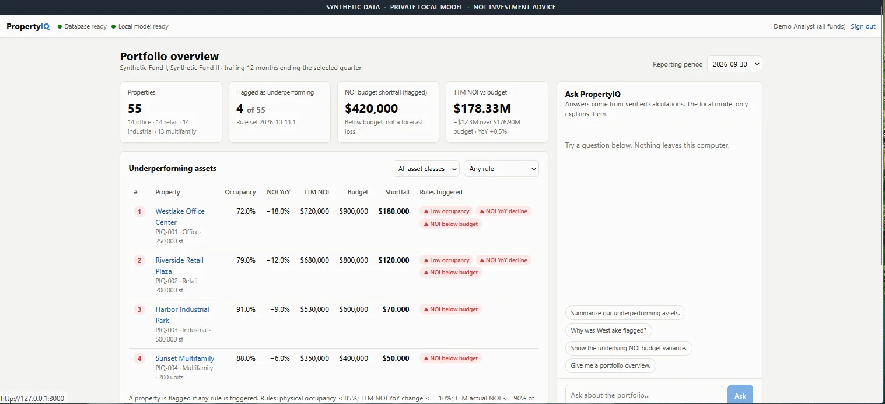
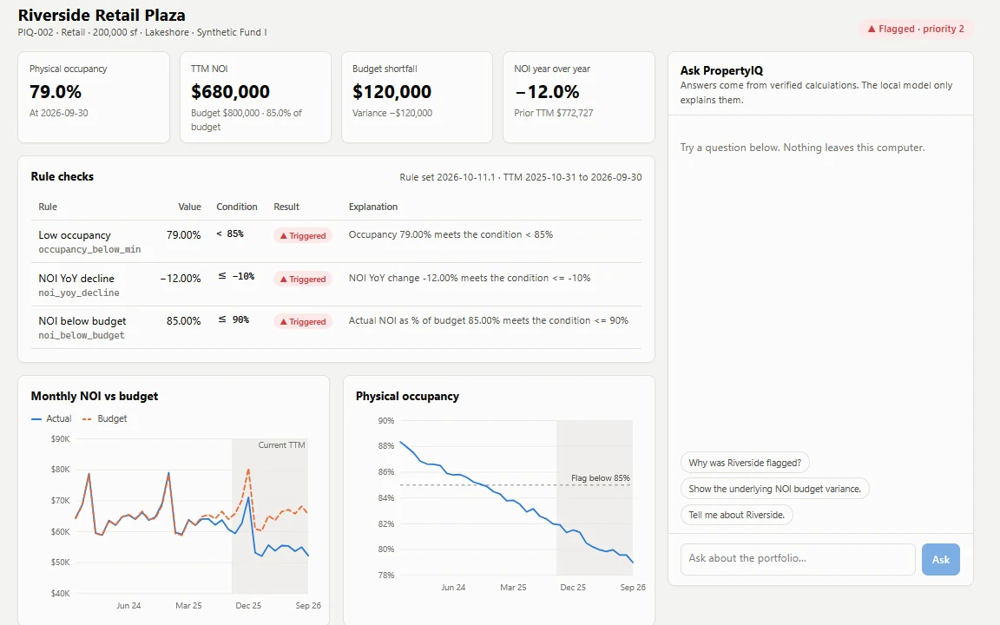
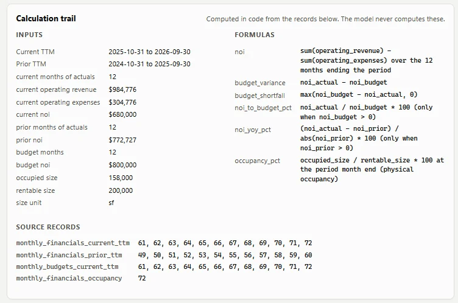
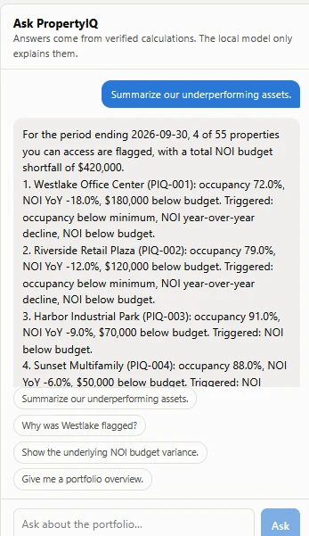
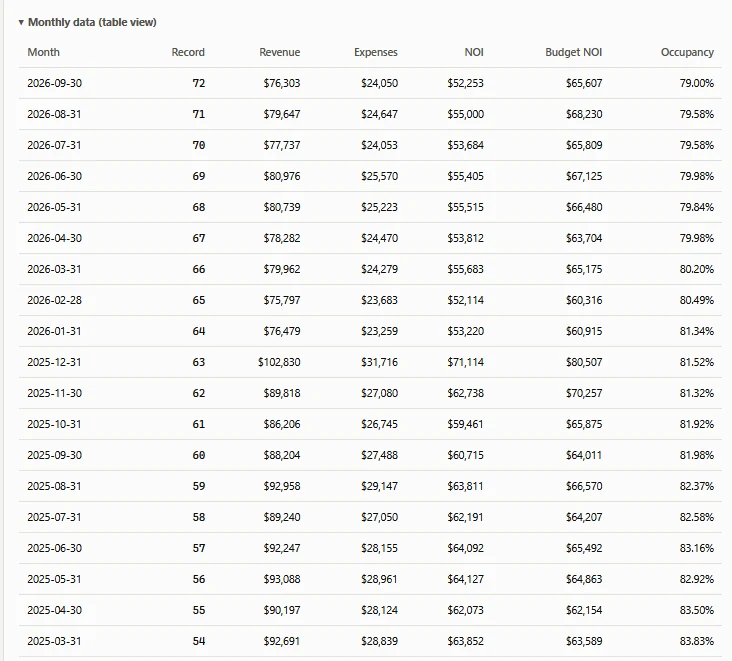
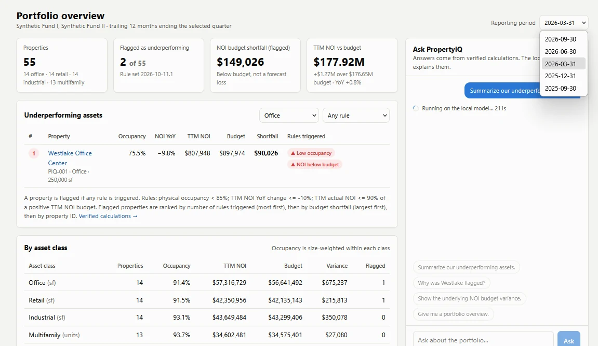
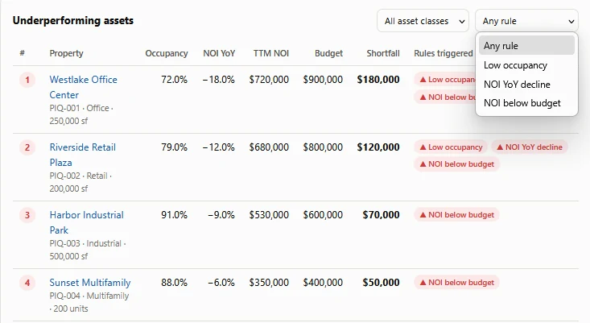
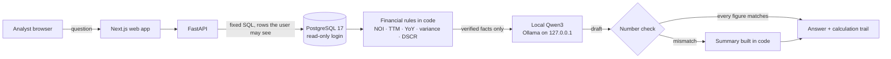

# PropertyIQ

**A self-hosted AI analyst and lending workbench for commercial real estate. The AI runs on one machine, and the model never does the math.**

PropertyIQ analyzes a **synthetic** 55-property portfolio and 46 synthetic loans. Application code calculates every figure from PostgreSQL. A local Qwen3 model, served by Ollama, only explains the verified results in plain English. No hosted AI API is used: inference, embeddings, OCR and the database all run on the local host.

It is a proof of concept built to show how a private, auditable AI system for real estate finance could work. It isn't a financial advisory product, and every property, loan, tenant and document in it is made up.



[Read the case study](https://ky-gray-portfolio.vercel.app/propertyiq) · [Try the simulator demo](https://ky-gray-portfolio.vercel.app/propertyiq-demo) (in your browser, synthetic data, scripted chat) · [Architecture](docs/architecture.md) · [Security boundary](docs/security-boundary.md)

---

## Highlights

- **The model never does the math.** NOI, trailing-12-month totals, year-over-year change, budget variance, occupancy, DSCR, LTV and covenant tests are calculated in SQL and Python. The model receives only verified facts. Every dollar amount and percentage it writes is checked against those facts, and if any number doesn't match, the answer is rebuilt in code instead.
- **Every figure shows its work.** Answers link to a calculation trail: inputs, formulas, reporting windows, monthly source record IDs and a SHA-256 of the facts the model saw.
- **Local by design.** Services listen on `127.0.0.1` only, the model adapter refuses remote hosts, and no hosted-AI library is installed. An admin page checks all of this live, with evidence.
- **Access is enforced in the database queries,** not in prompts. A user who can't see a fund's loans gets the same 404 as for a loan that doesn't exist.
- **279 automated tests.** Expected loan values come from the specification and from an independent plain-math version of each formula, and every exported Excel workbook is recalculated in OpenOffice and must match the app.

## What's inside

| Module | What it does |
|---|---|
| **Portfolio analytics** | 55 synthetic office, retail, industrial and multifamily properties. Rule checks flag underperformers (4 of 55 for the period ending 2026-09-30, a $420,000 combined budget shortfall). Property drill-downs, filters, historical periods and a local AI chat. |
| **Loan screening** | NOI, DSCR (amortizing and interest-only), LTV, debt yield, implied cap rate, break-even occupancy and debt constant against a lender's guideline set, with rate, vacancy, income, expense and exit-cap stress tests. Exports a one-page PDF and an Excel workbook with live formulas. Uses no AI. |
| **Document intake** | Reads a borrower's rent roll and T-12 from Excel, CSV, text PDF or scanned PDF (local OCR). Every row shows its source and a confidence level; nothing is used until it's approved. Tenant names are dropped while the file is read. |
| **Red flags** | 13 document checks (A1–A13), a market check against comps from an offline synthetic provider (M1), and California checks (R1–R5: Prop 13 reset, rent control, seismic, environmental, condition). Each California rule carries its official source URL and the date it was verified; anything unconfirmed is marked UNVERIFIED. |
| **Underwriting comparison** | The borrower's numbers next to the lender's. Flags become suggested adjustments that need a reason code and a note. For the demo deal: *"Underwriting adjustments reduce NOI by $178,195 (37.1%), moving DSCR from 1.58 to 1.00, which fails the 1.25 minimum."* That sentence is built from the numbers, not written by the model. |
| **Debt dashboard** | 46 synthetic loans: maturity wall, DSCR × LTV risk map, covenant watchlist and per-loan calculation trails. Balances and ratios are computed from loan terms on each request, never stored. |
| **AI Engineering Lab** | Request traces with stage timings, the vetted function used, number-check result, model, token counts and source records, without storing the question or answer text (30-day retention). A model on/off test proves the facts are identical either way. |
| **Admin** | A live security checklist with evidence for every item, an internet lockdown switch (Windows Firewall, through the Windows permission prompt) and backups that pass a restore test. |

## Screenshots

| | |
|---|---|
|  |  |
| **Property drill-down.** Each rule shows its value, condition and result, beside 36 months of NOI and occupancy. | **Calculation trail.** Inputs, formulas, both 12-month windows and the monthly record IDs behind each figure. |
|  |  |
| **Local AI answer.** Generated on the machine, citing the same four properties and figures the dashboard shows. | **Monthly source records.** Revenue, expenses, NOI, budget and occupancy, so any total can be reconciled by hand. |
|  |  |
| **Historical periods.** Change the period and everything recalculates: 2 of 55 flagged at 2026-03-31. | **Rule filter.** Narrow the flagged list to low occupancy, NOI decline or NOI below budget. |

## How an answer is made



1. The API routes the question to a vetted function. The model never sees SQL.
2. Code queries only the rows the user is allowed to see, and computes every metric and rule result.
3. The model gets those facts and record IDs, and writes an explanation.
4. Every number in the draft is checked against the facts. The interface labels the answer **"Local model · figures verified"** or **"Verified summary"** (built in code).

## Tech stack

| Layer | Choice |
|---|---|
| Host | Windows 11, Docker Desktop on WSL 2 |
| Interface | Next.js 16, React 19, TypeScript, strict Content Security Policy, system fonts |
| API | FastAPI (Python), signed expiring tokens |
| Database | PostgreSQL 17 with pgvector, in Docker, bound to `127.0.0.1` |
| Chat model | `qwen3:4b-instruct-2507-q4_K_M` via Ollama (Apache 2.0); about 8–18 s per answer on a 4 GB laptop GPU |
| Embeddings | `nomic-embed-text` (768-dim, Apache 2.0) |
| Documents | pdfplumber, pypdfium2 and RapidOCR (offline) |
| Exports | ReportLab (PDF) and openpyxl (Excel with real formulas) |

## Status

| Milestone | Status |
|---|---|
| 0: Environment, model choice, architecture, threat model | ✅ Done |
| 1a: Schema, synthetic seed, verified analytics API, tests | ✅ Done |
| 1b: Next.js UI and local AI chat, with checked figures | ✅ Done |
| Tier 1: Loan screening (guidelines, stress tests, PDF and Excel export) | ✅ Done. See [loan-screening.md](docs/loan-screening.md). |
| Tier 2: Document intake, anomaly flags, market comps, California red flags, underwriting comparison | ✅ Done. See [document-intake.md](docs/document-intake.md). |
| Admin checklist, internet lockdown, tested backups | ✅ Built. The lockdown hasn't been run live yet. See [admin-lockdown.md](docs/admin-lockdown.md). |
| Debt dashboard | ✅ Done. See [debt-dashboard.md](docs/debt-dashboard.md). |
| AI Engineering Lab | ✅ Done. See [ai-lab.md](docs/ai-lab.md). |
| Next: viewer / analyst / credit officer roles, fund-scoped deals, access audit | Planned |
| Then: NOI waterfall, lease rollover, concentration, data quality | Planned |

**Not claimed:** PropertyIQ isn't described as secure, compliant or production-ready. Network isolation still has to be tested and recorded, and production sign-in (multi-factor, lockout, token revocation), role-based access and encryption at rest and in transit are still to do. See [security-boundary.md](docs/security-boundary.md).

## Setup (Windows 11)

Requires Docker Desktop (WSL 2), Ollama, Python 3.12+, Node 20+ and Git.

```powershell
# 1. Secrets: create .env with POSTGRES_PASSWORD=..., then fill in the rest automatically
py -m venv .venv
.\.venv\Scripts\python.exe -m pip install -r services\api\requirements.txt
.\.venv\Scripts\python.exe scripts\init_env.py

# 2. Database (pgvector image, bound to 127.0.0.1 only)
docker compose up -d
.\.venv\Scripts\python.exe scripts\db_bootstrap.py      # database logins
.\.venv\Scripts\python.exe scripts\migrate.py
.\.venv\Scripts\python.exe scripts\seed.py              # 55 synthetic properties and 46 loans
.\.venv\Scripts\python.exe scripts\screening_setup.py   # loan screening module
.\.venv\Scripts\python.exe scripts\lab_setup.py         # AI Lab request traces
.\.venv\Scripts\python.exe scripts\set_demo_password.py # demo sign-in password (hidden prompt)

# 3. Local models (one-time download, about 2.8 GB)
ollama pull qwen3:4b-instruct-2507-q4_K_M
ollama pull nomic-embed-text

# 4. Web app
cd apps\web
npx next telemetry disable
npm install
npm run build
cd ..\..
```

## Run and test

```powershell
# Start the API (127.0.0.1:8000) and web app (127.0.0.1:3000) and open the browser.
# Starts Docker Desktop and Ollama if needed; safe to run again.
powershell -ExecutionPolicy Bypass -File scripts\start.ps1

# All tests (unit, database, authorization, chat, exports, live local model)
.\.venv\Scripts\python.exe -m pytest -q

# Web type check and production build
cd apps\web; npx tsc --noEmit; npm run build

# Back up the database and uploads, then test-restore into a scratch database
.\.venv\Scripts\python.exe scripts\backup.py
```

Demo sign-ins are `analyst` (all 55 properties) and `restricted` (Synthetic Fund II only). Passwords live only in `.env`, which is git-ignored.

## Pages

| Page | What it shows |
|---|---|
| `/` | Portfolio overview: KPIs, flagged assets with filters, asset-class table, reporting-period selector, chat |
| `/properties/{id}` | Rule checks, 36-month NOI-vs-budget and occupancy charts, calculation trail, monthly table |
| `/verified` | The exact verified payload and its SHA-256 |
| `/screening` | Loan screening, guideline PASS/FAIL, stress tests, DSCR grid, exports |
| `/screening/deals` | Deal workspace: Upload → Review → Flags → Market → California → Compare → Export |
| `/screening/settings` | Benchmarks, California rules with sources, component typical life |
| `/debt`, `/debt/{id}` | Debt dashboard and loan detail |
| `/lab` | AI Engineering Lab: overview, traces, model on/off, models, tools, schema, offline evidence |
| `/admin` | Admin only: security checklist and internet lockdown |

## API

| Endpoint | Purpose |
|---|---|
| `GET /health` | Database and local-model readiness (true/false only) |
| `POST /api/auth/login` | Sign-in; returns a bearer token |
| `GET /api/periods`, `/api/rules` | Reporting periods; active rule set |
| `GET /api/properties/underperforming?period=` | Flagged properties with rules, inputs, formulas, source record IDs and `payload_sha256` |
| `GET /api/portfolio/summary?period=` | Counts, asset-class mix, occupancy, NOI actual vs budget |
| `GET /api/properties/{id}?period=` | One property: assessment plus 36-month history |
| `POST /api/chat` | Question → routing → verified facts → local model → number check |
| `GET /api/debt/summary?period=`, `/api/debt/loans/{id}` | Loans in the user's funds: totals, maturity wall, covenants, calculation trail |
| `GET /api/lab/*`, `POST /api/lab/compare` | AI Engineering Lab (traces limited to your own; admins see all) |
| `GET /api/admin/checklist`, `GET`/`POST /api/admin/lockdown` | Admin only: live checklist; lockdown status and fixed modes (`app`, `computer`, `off`) |

## Layout

```text
docker-compose.yml          Postgres 17 + pgvector, 127.0.0.1 only
apps/web/                   Next.js UI (strict CSP, proxies /api to the API)
db/migrations/              SQL migrations 0001–0009 (schema piq)
db/seeds/                   The four required demo properties
services/api/propertyiq/    FastAPI app
  finance.py, analytics.py    rules and vetted SQL
  chat.py, llm.py             routing, number check, local model adapter
  screening/                  loan screening, document intake, flags, comparison, exports
  lending/                    debt dashboard
  lab/                        AI Engineering Lab and request traces
  admin/                      security checklist and lockdown
scripts/                    setup, seed, backup, lockdown, start.ps1
tests/                      pytest suite and synthetic document fixtures
docs/                       architecture, security, definitions, evaluation, module guides
```

## Documents

- [Architecture](docs/architecture.md) and [current state](docs/architecture/current-state.md)
- [Security boundary and threat model](docs/security-boundary.md)
- [Financial definitions and rules](docs/financial-definitions.md)
- [Model evaluation](docs/model-evaluation.md)
- [Demo script](docs/demo-script.md)
- [Loan screening](docs/loan-screening.md)
- [Document intake and underwriting](docs/document-intake.md)
- [Debt dashboard](docs/debt-dashboard.md)
- [AI Engineering Lab](docs/ai-lab.md)
- [Admin: checklist, lockdown and backups](docs/admin-lockdown.md)

## About

Built by Ky Gray with Claude Code, from my own brief and specifications. More of my work: [ky-gray-portfolio.vercel.app](https://ky-gray-portfolio.vercel.app).

All data is synthetic. PropertyIQ is a prototype and not investment advice.
