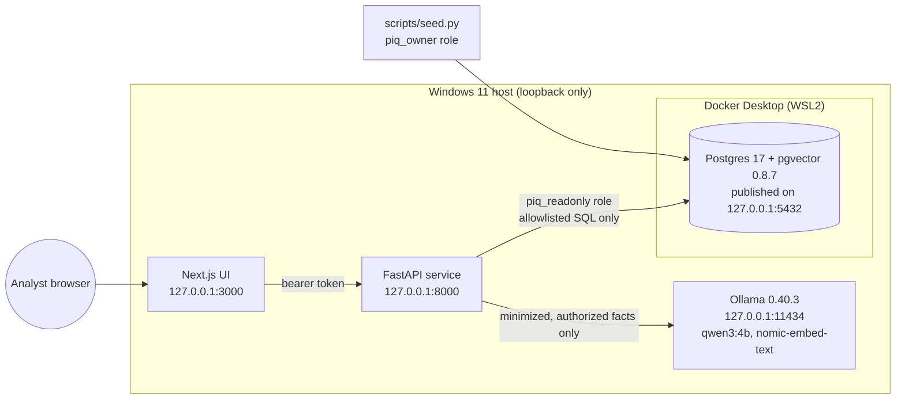

# PropertyIQ architecture

PropertyIQ is a proof of concept: a private analytics assistant for a **fictional** real estate portfolio. Everything runs on one Windows machine. No hosted AI APIs, no cloud database, no external telemetry from the application.

## Components

| Component | Where it runs | Listens on | Notes |
|---|---|---|---|
| Postgres 17 + pgvector | Docker container `propertyiq-postgres` | `127.0.0.1:5432` | Data in Docker volume `pgdata` |
| API (FastAPI, Python 3.14) | Host, `.venv` | `127.0.0.1:8000` | Connects only as `piq_readonly` |
| Local model (Ollama) | Host, Windows app | `127.0.0.1:11434` | Chat: `qwen3:4b`. Embeddings: `nomic-embed-text` (768-dim) |
| UI (Next.js 16, React 19) | Host | `127.0.0.1:3000` | Proxies `/api` and `/health` to the API. A Content Security Policy limits the browser to this origin. |

The API runs on the host for now because Ollama does too. Moving the API into Compose later needs `host.docker.internal` to reach Ollama; that path must be checked so Ollama is never bound to `0.0.0.0`.

## Request flow: "Summarize our underperforming assets"

1. **Who is asking.** The bearer token is checked (HMAC-signed, 8-hour expiry) and the user's portfolio grants are loaded from `user_portfolio_access`.
2. **Which period.** Defaults to the latest quarter end with full current and prior trailing-12-month windows (2026-09-30). Other periods must be in the allowlisted set.
3. **Vetted query.** `analytics.evaluate_properties()` runs one fixed, parameterized SQL statement. The user's portfolio grants are part of the `JOIN`, so unauthorized rows never leave the database.
4. **Deterministic rules.** `finance.evaluate()` computes NOI, variance, shortfall, YoY and occupancy in Python `Decimal` and applies the rule set in `rules.json`. Priority is a fixed sort.
5. **Verified payload.** `GET /api/properties/underperforming` returns every flag with its rule, threshold, inputs, formulas, period windows and the source `record_id`s, plus a `payload_sha256`.
6. **Narrative (`POST /api/chat`).**
   - **Routing:** `chat.route()` sends the question to an analytics function using keyword rules. Property names are matched only against properties the user can see. Refusals (investment advice, cap rate and DSCR, forecasts, leases) never reach the model.
   - **What the model sees:** only the minimized facts for that question, as JSON marked "data, not instructions".
   - **Number check:** every dollar amount and percentage in the answer must match those facts. Otherwise a deterministic summary from the same facts is shown.
   - **Failures:** if the model is down, slow or cut off, the verified summary is shown with a note.
7. **Documents (Milestone 2).** Retrieval will be filtered by the same portfolio grants *before* any text reaches the model.

## Data model (schema `piq`)

- `portfolios`, `properties`: every row has `is_synthetic = true`, enforced by a `CHECK` constraint.
- `monthly_financials`: one row per property per month. `noi` is a generated column (`operating_revenue - operating_expenses`), so NOI can't drift from its inputs.
- `monthly_budgets`: same shape, with a generated `budget_noi`.
- `demo_users`, `user_portfolio_access`: demo sign-in and authorization.
- `seed_runs`: which generator, seed and content hash produced the current data.

Synthetic data: 55 properties (14 office, 14 retail, 14 industrial, 13 multifamily) in two portfolios, with 36 months of actuals and budgets (Oct 2023 – Sep 2026). See [financial-definitions.md](financial-definitions.md).

## Database roles

| Role | Can do | Used by |
|---|---|---|
| `postgres` | Superuser | `scripts/db_bootstrap.py` only |
| `piq_owner` | Owns schema `piq` | `scripts/migrate.py`, `scripts/seed.py` |
| `piq_readonly` | `SELECT` on `piq` tables; read-only transactions; 5-second statement timeout | The API |
| `piq_screening_writer` | Changes `screening_*` tables only | Loan screening saves |
| `piq_trace_writer` | Adds and prunes `request_traces` only | AI request traces |
| `piq_audit_writer` | Adds and prunes `access_audit` only; can't edit rows | Access audit ([access-control.md](access-control.md)) |

`CREATE` on `public` is revoked from everyone, and the database refuses connections from roles that weren't granted access.

## LLM provider abstraction

`propertyiq.llm.LLMProvider` defines `available()`, `chat()` and `embed()`. `OllamaProvider` is the only implementation; a vLLM provider can be added behind the same interface. The adapter enforces:

- **Local endpoints only.** The endpoint must be loopback, a private IP, or a known local hostname. Link-local addresses (cloud metadata) and public hosts are refused.
- **Model allowlist.** Only models in `PIQ_ALLOWED_MODELS` can be called. Ollama `*-cloud` models are always refused.
- **No proxies or redirects.** `trust_env=False` ignores proxy environment variables, and redirects aren't followed.
- **Reasoning handled per model.** The adapter asks Ollama whether the chat model is a reasoning model (`/api/show`):
  - **Reasoning model:** it sends `think: true`, so the reasoning arrives in a separate field that is thrown away. Sending `think: false` to qwen3 makes it write its reasoning into the answer instead.
  - **Cut-off answers:** an answer that hits the token limit is treated as a failure.
  - **Backstop:** any leftover `</think>` text is stripped as a final safeguard.
